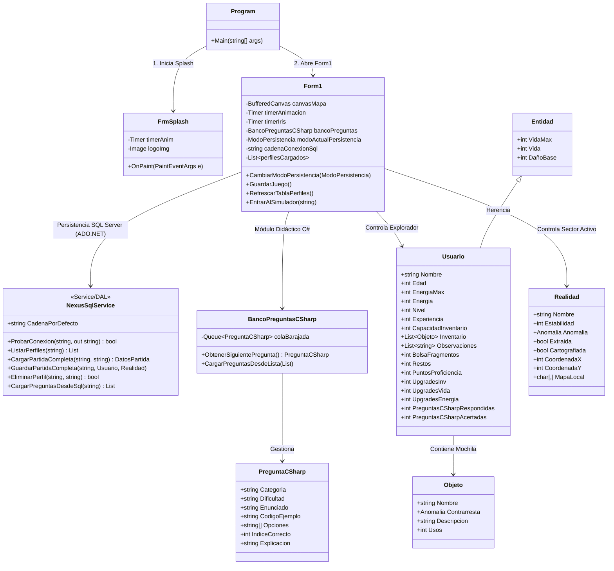

# Arquitectura Actual del Sistema: NEXUS (v1.1.0 — Hito 4: Persistencia Dual JSON + SQL Server)

## 1. Resumen Ejecutivo y Estado del Proyecto
La versión **v1.1.0** de **NEXUS** consolida la evolución del sistema hacia la **Operación Memoria (Hito 4 — UNIFRANZ)**, incorporando una **arquitectura de persistencia dual**:
1. **Almacenamiento Local en JSON:** Modo autónomo basado en serialización `System.Text.Json` en `%LocalAppData%\NEXUS\Saves\*.json`, ideal para distribución ligera sin dependencias externas.
2. **Almacenamiento Relacional en Microsoft SQL Server (`NexusDB`):** Alternativa transaccional en Tercera Forma Normal (3FN) desarrollada con **ADO.NET puro (`Microsoft.Data.SqlClient`)**, soportando transacciones ACID explícitas (`SqlTransaction`), consultas parametrizadas, eliminación en cascada y catálogo dinámico de trivias de C#.

El motor visual conserva su arquitectura orientada a eventos con renderizado 2D en GDI+ a ~30 FPS (`BufferedCanvas`), animaciones suaves y módulo didáctico de trivias de C#.

---

## 2. Diagrama de Estructura de Clases Actual

---

## 3. Inventario y Análisis de Componentes

### 3.1. `NexusSqlService.cs` (Capa de Acceso a Datos / DAL)
Ubicada en el proyecto `src/Interfaz`, encapsula todas las interacciones con Microsoft SQL Server mediante ADO.NET:
- **`ProbarConexion(string cadena, out string mensaje)`:** Abre una conexión a SQL Server, consulta la versión y valida que la base `NexusDB` responda correctamente.
- **`ListarPerfiles(string cadena)`:** Invoca el procedimiento almacenado `sp_ListarPerfiles` para obtener el listado rápido de cadetes y sus estados sin bloquear la UI.
- **`CargarPartidaCompleta(string cadena, string nombre)`:** Ejecuta `sp_CargarPartidaPorNombre` para recuperar en 3 result sets continuos el perfil de `Usuario`, su estado en `Realidad`, los objetos activos en `T_Inventarios` y las pistas de anomalía en `T_Observaciones`.
- **`GuardarPartidaCompleta(string cadena, Usuario jugador, Realidad realidad)`:** Inicia una transacción explícita (`SqlTransaction` con `IsolationLevel.ReadCommitted`):
  1. Invoca `sp_GuardarPartidaCabecera` para sincronizar `T_Jugadores` y `T_Partidas_Activas`, capturando el `@JugadorIdOutput`.
  2. Depura y reinserta atómicamente los ítems en `T_Inventarios`.
  3. Depura y reinserta las pistas en `T_Observaciones`.
  4. Ejecuta `transaction.Commit()`. Ante cualquier error invoca `Rollback()` y preserva la integridad del estado.
- **`EliminarPerfil(string cadena, string nombre)`:** Invoca `sp_EliminarPerfil` aprovechando las llaves foráneas con `ON DELETE CASCADE` para limpiar de raíz toda la información asociada al jugador.
- **`CargarPreguntasDesdeSql(string cadena)`:** Carga dinámicamente el catálogo de reactivos técnicos desde `T_Preguntas_CSharp`.

### 3.2. Controles de Persistencia Dual en `Form1`
El panel inicial (`pnlPerfiles`) incorpora el grupo **`grpPersistencia`** con:
- **Selector de Modo:** RadioButtons `rbPersistenciaJson` y `rbPersistenciaSql`.
  - Al cambiar a SQL Server, verifica la conectividad en vivo. Si tiene éxito, carga las partidas desde `NexusDB`; de lo contrario, advierte al usuario y revierte a JSON.
- **Botón `⚡ PROBAR CONEXIÓN`:** Ejecuta un test inmediato contra la instancia de SQL Server configurada.
- **Botón `⚙️ CONFIGURAR CADENA`:** Abre un diálogo interactivo para personalizar la cadena de conexión ADO.NET o restaurar la predeterminada (`Server=.\SQLEXPRESS;Database=NexusDB;Trusted_Connection=True;TrustServerCertificate=True;`).
- **Botón `🔄 MIGRAR PARTIDAS JSON A SQL SERVER`:** Lee todos los archivos `.json` existentes en `%LocalAppData%\NEXUS\Saves` y los inserta de forma transaccional en SQL Server, facilitando la transición y demostración docente.
- **Etiquetas de Estado y Telemetría:** Muestran el estado de conexión del motor en tiempo real (`lblEstadoSql`) y la cadena activa (`lblDetalleMotor`).

### 3.3. Ciclo de Vida del Guardado (`GuardarJuego()`)
`GuardarJuego()` evalúa si el perfil activo fue abierto o creado en SQL Server (`rutaGuardadoActual.StartsWith("[SQL]:")` o modo `SqlServer`). En dicho caso, delega el guardado a `NexusSqlService.GuardarPartidaCompleta(...)`. Si está en modo JSON, genera el archivo `.json` en `%LocalAppData%\NEXUS\Saves`.
Este método se invoca automáticamente en puntos clave:
- Al crear un explorador nuevo.
- Al regresar de una expedición al campamento (`IntentarVolverAlCampamento`).
- Al realizar compras en la tienda o adquirir mejoras de proficiencia.
- Al responder filtros didácticos de C# en el modal de soporte vital.
- Al cerrar el videojuego (`FormClosing`), garantizando supervivencia total del progreso.

---

## 4. Estructura de la Base de Datos Relacional (`database/`)

El repositorio incluye una carpeta raíz `database/` con scripts SQL numerados y versionados:
- **`01_CrearBaseDatos.sql`:** Crea la base de datos `NexusDB` con cotejo `Latin1_General_CI_AS` y banderas ANSI.
- **`02_CrearTablasYRelaciones.sql`:** Define las 6 tablas relacionales (`T_Jugadores`, `T_Partidas_Activas`, `T_Inventarios`, `T_Observaciones`, `T_Preguntas_CSharp`, `T_Historial_Incursiones`) con restricciones `PRIMARY KEY`, `FOREIGN KEY ON DELETE CASCADE`, `CHECK` y `UNIQUE`.
- **`03_ProcedimientosAlmacenados.sql`:** Implementa los procedimientos almacenados de guardado atómico, carga multiconjunto, listado y eliminación en cascada.
- **`04_CargaInicialPreguntas.sql`:** Inserta las 28 preguntas pedagógicas de C# verificadas.
- **`05_ScriptCompleto_NexusDB.sql`:** Script monolítico unificado para despliegue rápido.
- **`ejecutar_scripts.ps1`:** Script PowerShell para ejecutar en secuencia todo el despliegue con un solo comando.
