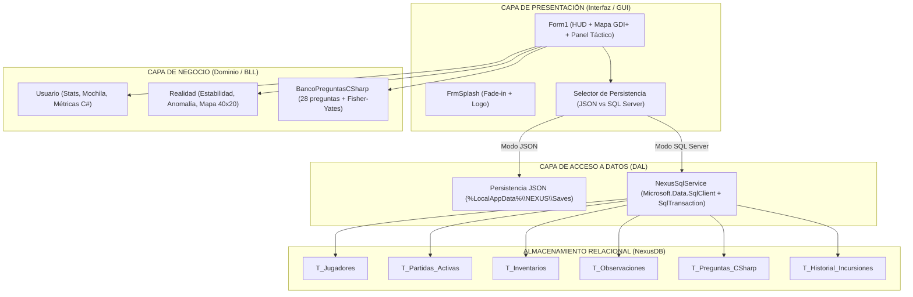

# Arquitectura Propuesta y Evolución N-Capas (Hito 4)

## 1. Estado de Avance de la Migración
La evolución técnica y arquitectónica de **NEXUS** ha alcanzado sus dos hitos estratégicos:

- **Fase 1 (COMPLETADA — v1.0.0):**
  - Migración total desde consola hacia **Windows Forms** con arquitectura *Event-Driven*.
  - Renderizado matricial GDI+ con doble búfer (`BufferedCanvas`) y ciclo de animación a ~30 FPS (`timerAnimacion` + partículas + textos flotantes + interpolación).
  - Pantalla de inicio animada (`FrmSplash`), branding oficial (`Assets/`) y módulo didáctico de C# con Fisher-Yates (`BancoPreguntasCSharp.cs`).
  - Persistencia segura en `%LocalAppData%\NEXUS\Saves` y empaquetado autónomo con **Inno Setup** (`NEXUS_Setup_v1.0.exe`).
- **Fase 2 (COMPLETADA — v1.1.0 — Operación Memoria Hito 4):**
  - Implementación de **Persistencia Dual (JSON Local + Microsoft SQL Server)**.
  - Creación del componente de acceso a datos **`NexusSqlService` (DAL)** con **ADO.NET (`Microsoft.Data.SqlClient`)**.
  - Diseño y despliegue del modelo relacional en Tercera Forma Normal (3FN) con 6 tablas (`T_Jugadores`, `T_Partidas_Activas`, `T_Inventarios`, `T_Observaciones`, `T_Preguntas_CSharp`, `T_Historial_Incursiones`).
  - Transacciones atómicas ACID (`SqlTransaction`) y procedimientos almacenados para guardado, carga multiconjunto y eliminación en cascada.
  - Conmutador en tiempo real desde la interfaz de usuario con prueba de conexión, configuración de cadena y migración de partidas JSON a SQL.

---

## 2. Capas del Sistema (Arquitectura N-Tier Implementada)

### 2.1. Capa de Presentación (`NEXUS.GUI` / Proyecto `Interfaz`)
Proyecto de tipo *Windows Forms App* (`net10.0-windows`).
- **Responsabilidad:** Capturar eventos de usuario (teclado, ratón, timers), ejecutar el renderizado GDI+ en `BufferedCanvas`, gestionar diálogos modales y proveer controles de selección de persistencia (JSON vs SQL Server).
- **Componentes:** `FrmSplash`, `Form1` (HUD, Panel Táctico, Log, Gestor de Perfiles, Panel de Persistencia) y diálogos modales interactivos (Combate, Soporte Vital / Trivia C#, Inventario, Tienda, Atlas).

### 2.2. Capa de Entidades y Lógica de Negocio (`NEXUS.BLL`)
- **Entidades de Dominio:** `Entidad`, `Usuario`, `Enemigo`, `Realidad`, `Objeto`, `EntidadIris`, `AtlasRealidades`, `PreguntaCSharp`.
- **Servicios y Reglas:**
  - Validación de exploración y consumo de energía cuántica cada 3 pasos.
  - Combate por turnos con probabilidades de impacto y escape.
  - Banco didáctico barajado con Fisher-Yates y alimentación opcional desde SQL Server.
  - Monitoreo de estabilidad multiversal e intervención del enjambre antagonista I.R.I.S.

### 2.3. Capa de Acceso a Datos (`NEXUS.DAL` / `NexusSqlService`)
- **Responsabilidad:** Encapsular la conectividad con Microsoft SQL Server mediante ADO.NET (`Microsoft.Data.SqlClient`), garantizando:
  - **Consultas 100% Parametrizadas:** Prevención absoluta de inyección SQL.
  - **Transacciones ACID Explícitas (`SqlTransaction`):** Guardado integral de cabecera, realidad, ítems y observaciones dentro de una sola unidad de trabajo atómica.
  - **Procedimientos Almacenados:** Reducción de tráfico de red y encapsulamiento de lógica relacional en la base de datos (`sp_GuardarPartidaCabecera`, `sp_CargarPartidaPorNombre`, `sp_ListarPerfiles`, `sp_EliminarPerfil`, `sp_ObtenerPreguntasCSharp`).

---

## 3. Diagrama de Flujo y Dependencias

---

## 4. Garantías de Supervivencia y Transaccionalidad
Ante un evento de guardado en modo SQL Server:
1. `NexusSqlService` abre una conexión `SqlConnection` hacia `NexusDB`.
2. Se inicia una transacción atómica `conn.BeginTransaction()`.
3. Se ejecuta `sp_GuardarPartidaCabecera` para sincronizar `T_Jugadores` y `T_Partidas_Activas`.
4. Se sincronizan en cascada los registros de `T_Inventarios` y `T_Observaciones`.
5. Se invoca `trans.Commit()`. Si cualquier operación genera una excepción, se ejecuta `trans.Rollback()`, asegurando que ninguna partida quede en estado inconsistente.
