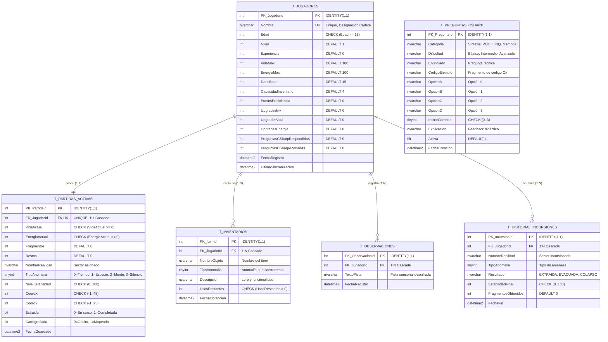

# Modelo de Datos Relacional para Microsoft SQL Server (NexusDB)

## 1. Justificación y Estado de la Integración (Hito 4)
En la versión inicial (**v1.0.0**), NEXUS almacenaba sus partidas en archivos planos JSON dentro de `%LocalAppData%\NEXUS\Saves\*.json`. Con el propósito de implementar **Operación Memoria (Hito 4 - UNIFRANZ)**, se diseñó e integró un sistema de persistencia relacional sobre **Microsoft SQL Server (NexusDB)**, operando en paralelo con el guardado en JSON mediante una **arquitectura de persistencia dual**.

### Beneficios del Modelo Relacional frente a Archivos Planos:
- **Propiedades ACID Completas:** Atomicidad, Consistencia, Aislamiento y Durabilidad mediante transacciones explícitas (`SqlTransaction`). Si ocurre una falla a mitad del guardado, la base de datos realiza `ROLLBACK` y previene partidas a medio escribir o corruptas.
- **Normalización en Tercera Forma Normal (3FN):** Los datos del jugador, el estado volátil de la realidad, los objetos de la mochila, las observaciones sensoriales y las trivias educativas no están mezclados en un solo bloque no estructurado, sino desacoplados en entidades relacionales conectadas por claves foráneas con eliminación en cascada (`ON DELETE CASCADE`).
- **Consultas Parametrizadas y Seguridad:** Eliminación total de inyección SQL mediante el paso estricto de parámetros fuertemente tipados en ADO.NET (`Microsoft.Data.SqlClient`).
- **Escalabilidad Educativa:** Centralización de las 28 preguntas técnicas de C# en una tabla de catálogo (`T_Preguntas_CSharp`), permitiendo incorporar nuevos reactivos o corregir explicaciones didácticas sin necesidad de recompilar `NEXUS.exe`.

---

## 2. Diagrama Entidad-Relación (DER)



---

## 3. Diccionario de Datos Detallado

### 3.1. `dbo.T_Jugadores`
Entidad principal del cadete explorador. Conserva su perfil biométrico, progreso multiversal, mejoras acumuladas y estadísticas didácticas de C#.

| Campo | Tipo | Nulo | Restricción / Valor por Defecto | Descripción |
| :--- | :--- | :---: | :--- | :--- |
| `PK_JugadorId` | `INT` | NO | `IDENTITY(1,1) PRIMARY KEY` | Identificador único del explorador. |
| `Nombre` | `NVARCHAR(50)` | NO | `UNIQUE` | Designación del cadete. Clave de búsqueda de perfil. |
| `Edad` | `INT` | NO | `CHECK (Edad >= 18)` | Edad biométrica obligatoria validada en el registro. |
| `Nivel` | `INT` | NO | `DEFAULT 1, CHECK (Nivel >= 1)` | Rango actual del explorador. |
| `Experiencia` | `INT` | NO | `DEFAULT 0, CHECK (Experiencia >= 0)` | Experiencia acumulada (100 exp = 1 nivel + 1 punto de proficiencia). |
| `VidaMax` | `INT` | NO | `DEFAULT 100, CHECK (VidaMax > 0)` | Límite máximo de integridad vital. |
| `EnergiaMax` | `INT` | NO | `DEFAULT 100, CHECK (EnergiaMax > 0)` | Límite máximo de energía cuántica de soporte. |
| `DanoBase` | `INT` | NO | `DEFAULT 15, CHECK (DanoBase > 0)` | Potencia de ataque base en combate táctico. |
| `CapacidadInventario` | `INT` | NO | `DEFAULT 4, CHECK (CapacidadInventario >= 1)` | Límite de ítems simultáneos en la mochila. |
| `PuntosProficiencia` | `INT` | NO | `DEFAULT 0, CHECK (PuntosProficiencia >= 0)` | Moneda de mejoras para la terminal de campamento. |
| `UpgradesInv` | `INT` | NO | `DEFAULT 0` | Contador de compras de ampliación de mochila. |
| `UpgradesVida` | `INT` | NO | `DEFAULT 0` | Contador de compras de incremento de salud. |
| `UpgradesEnergia` | `INT` | NO | `DEFAULT 0` | Contador de compras de incremento de energía. |
| `PreguntasCSharpRespondidas` | `INT` | NO | `DEFAULT 0` | Total de trivias técnicas de C# afrontadas. |
| `PreguntasCSharpAcertadas` | `INT` | NO | `DEFAULT 0, CHECK (Acertadas <= Respondidas)` | Total de respuestas correctas en los filtros de seguridad. |
| `FechaRegistro` | `DATETIME2(3)`| NO | `DEFAULT SYSDATETIME()` | Fecha y hora de creación del perfil. |
| `UltimaSincronizacion` | `DATETIME2(3)`| NO | `DEFAULT SYSDATETIME()` | Timestamp del último guardado en SQL Server. |

### 3.2. `dbo.T_Partidas_Activas`
Mapea el estado actual de la realidad asignada y los recursos volátiles en juego. Se modela como una relación **1 a 1** estricta con `T_Jugadores` mediante restricción `UNIQUE` en `FK_JugadorId`.

| Campo | Tipo | Nulo | Restricción / Valor por Defecto | Descripción |
| :--- | :--- | :---: | :--- | :--- |
| `PK_PartidaId` | `INT` | NO | `IDENTITY(1,1) PRIMARY KEY` | Identificador único del registro de partida. |
| `FK_JugadorId` | `INT` | NO | `UNIQUE, FOREIGN KEY ON DELETE CASCADE` | Llave foránea hacia `T_Jugadores(PK_JugadorId)`. |
| `VidaActual` | `INT` | NO | `CHECK (VidaActual >= 0)` | Puntos de vida actuales del jugador al guardar. |
| `EnergiaActual` | `INT` | NO | `CHECK (EnergiaActual >= 0)` | Puntos de energía actuales al guardar. |
| `Fragmentos` | `INT` | NO | `DEFAULT 0, CHECK (Fragmentos >= 0)` | Moneda de decodificación de pistas recolectada. |
| `Restos` | `INT` | NO | `DEFAULT 0, CHECK (Restos >= 0)` | Chatarra cuántica para compras y mejoras en tienda. |
| `NombreRealidad` | `NVARCHAR(100)`| NO | - | Nombre del sector multiversal actual (ej. *Horizonte Carmesí*). |
| `TipoAnomalia` | `TINYINT` | NO | `CHECK (TipoAnomalia BETWEEN 0 AND 3)` | 0: Tiempo, 1: Espacio, 2: Mente, 3: Silencio. |
| `NivelEstabilidad` | `INT` | NO | `CHECK (NivelEstabilidad BETWEEN 0 AND 100)` | Estabilidad dimensional del sector actual. |
| `CoordX` | `INT` | NO | `DEFAULT 0, CHECK (CoordX BETWEEN -1 AND 45)` | Coordenada horizontal del jugador en el mapa. |
| `CoordY` | `INT` | NO | `DEFAULT 0, CHECK (CoordY BETWEEN -1 AND 25)` | Coordenada vertical del jugador en el mapa. |
| `Extraida` | `BIT` | NO | `DEFAULT 0` | Indica si el sector ya fue estabilizado y extraído. |
| `Cartografiada` | `BIT` | NO | `DEFAULT 0` | Indica si la anomalía ya fue identificada con éxito. |
| `FechaGuardado` | `DATETIME2(3)`| NO | `DEFAULT SYSDATETIME()` | Timestamp exacto del guardado de la partida. |

### 3.3. `dbo.T_Inventarios`
Registra los artefactos tácticos en posesión del explorador. Relación **1 a N** con `T_Jugadores`.

| Campo | Tipo | Nulo | Restricción / Valor por Defecto | Descripción |
| :--- | :--- | :---: | :--- | :--- |
| `PK_ItemId` | `INT` | NO | `IDENTITY(1,1) PRIMARY KEY` | Identificador único del ítem en inventario. |
| `FK_JugadorId` | `INT` | NO | `FOREIGN KEY ON DELETE CASCADE` | Referencia al cadete propietario del objeto. |
| `NombreObjeto` | `NVARCHAR(100)`| NO | - | Nombre del artefacto (ej. *Reloj de Arena Invertido*). |
| `TipoAnomalia` | `TINYINT` | NO | `CHECK (TipoAnomalia BETWEEN 0 AND 3)` | Anomalía específica que este objeto contrarresta. |
| `Descripcion` | `NVARCHAR(300)`| SÍ | - | Lore y explicación didáctica del objeto. |
| `UsosRestantes` | `INT` | NO | `CHECK (UsosRestantes > 0)` | Durabilidad / cantidad de usos antes de destruirse. |
| `FechaObtencion`| `DATETIME2(3)`| NO | `DEFAULT SYSDATETIME()` | Momento en el que el objeto fue recogido o comprado. |

### 3.4. `dbo.T_Observaciones`
Pistas sensoriales decodificadas con Fragmentos para identificar la anomalía activa. Relación **1 a N** con `T_Jugadores`.

| Campo | Tipo | Nulo | Restricción / Valor por Defecto | Descripción |
| :--- | :--- | :---: | :--- | :--- |
| `PK_ObservacionId` | `INT` | NO | `IDENTITY(1,1) PRIMARY KEY` | Identificador de la pista decodificada. |
| `FK_JugadorId` | `INT` | NO | `FOREIGN KEY ON DELETE CASCADE` | Cadete que descubrió la observación. |
| `TextoPista` | `NVARCHAR(300)`| NO | - | Descripción sensorial para deducir la anomalía. |
| `FechaRegistro` | `DATETIME2(3)`| NO | `DEFAULT SYSDATETIME()` | Momento en el que se desbloqueó la pista. |

### 3.5. `dbo.T_Preguntas_CSharp`
Catálogo centralizado del módulo educativo de C# (28 preguntas técnicas).

| Campo | Tipo | Nulo | Restricción / Valor por Defecto | Descripción |
| :--- | :--- | :---: | :--- | :--- |
| `PK_PreguntaId` | `INT` | NO | `IDENTITY(1,1) PRIMARY KEY` | Número identificador de la pregunta. |
| `Categoria` | `NVARCHAR(80)` | NO | - | Sintaxis y Tipos, POO, Colecciones y LINQ, o Memoria/.NET. |
| `Dificultad` | `NVARCHAR(20)` | NO | `CHECK IN ('Básico', 'Intermedio', 'Avanzado')` | Nivel pedagógico de la pregunta. |
| `Enunciado` | `NVARCHAR(400)` | NO | - | Texto de la pregunta técnica. |
| `CodigoEjemplo` | `NVARCHAR(1000)`| SÍ | - | Bloque de código C# a analizar (opcional). |
| `OpcionA` | `NVARCHAR(250)` | NO | - | Respuesta opción A (Índice 0). |
| `OpcionB` | `NVARCHAR(250)` | NO | - | Respuesta opción B (Índice 1). |
| `OpcionC` | `NVARCHAR(250)` | NO | - | Respuesta opción C (Índice 2). |
| `OpcionD` | `NVARCHAR(250)` | NO | - | Respuesta opción D (Índice 3). |
| `IndiceCorrecto`| `TINYINT` | NO | `CHECK (IndiceCorrecto BETWEEN 0 AND 3)` | Índice de la respuesta válida (0 a 3). |
| `Explicacion` | `NVARCHAR(600)` | NO | - | Justificación didáctica tras responder. |
| `Activa` | `BIT` | NO | `DEFAULT 1` | Bandera para habilitar o desactivar el reactivo. |
| `FechaCreacion` | `DATETIME2(3)` | NO | `DEFAULT SYSDATETIME()` | Fecha de ingreso al banco didáctico. |

### 3.6. `dbo.T_Historial_Incursiones`
Historial de misiones del cadete para auditoría y métricas de desempeño. Relación **1 a N** con `T_Jugadores`.

| Campo | Tipo | Nulo | Restricción / Valor por Defecto | Descripción |
| :--- | :--- | :---: | :--- | :--- |
| `PK_IncursionId` | `INT` | NO | `IDENTITY(1,1) PRIMARY KEY` | Identificador único de la incursión registrada. |
| `FK_JugadorId` | `INT` | NO | `FOREIGN KEY ON DELETE CASCADE` | Cadete que realizó la incursión. |
| `NombreRealidad` | `NVARCHAR(100)`| NO | - | Sector multiversal explorado. |
| `TipoAnomalia` | `TINYINT` | NO | `CHECK (BETWEEN 0 AND 3)` | Tipo de anomalía del sector. |
| `Resultado` | `NVARCHAR(30)` | NO | `CHECK IN ('EXTRAIDA', 'EVACUADA', 'COLAPSO', 'EN_CURSO')` | Resultado de la expedición. |
| `EstabilidadFinal`| `INT` | NO | `CHECK (0..100)` | Porcentaje de estabilidad registrado al finalizar. |
| `FragmentosObtenidos`| `INT` | NO | `DEFAULT 0` | Ganancia de fragmentos en la misión. |
| `FechaFin` | `DATETIME2(3)` | NO | `DEFAULT SYSDATETIME()` | Timestamp de finalización de la expedición. |

---

## 4. Procedimientos Almacenados y Estrategia Transaccional

La integración implementa 5 procedimientos almacenados para desacoplar el motor SQL de la aplicación WinForms:

1. **`dbo.sp_ListarPerfiles`:** Ejecuta un `LEFT JOIN` entre `T_Jugadores` y `T_Partidas_Activas` para poblar el `DataGridView` inicial de selección de perfil sin exponer claves ajenas innecesarias.
2. **`dbo.sp_GuardarPartidaCabecera`:** Procedimiento atómico con `BEGIN TRANSACTION` y control `TRY...CATCH` que realiza un upsert sobre `T_Jugadores` y `T_Partidas_Activas`, devolviendo el `PK_JugadorId` generado o actualizado.
3. **`dbo.sp_CargarPartidaPorNombre`:** Ejecuta 3 consultas consecutivas en un único viaje de red (*batch query*) devolviendo el perfil del jugador, su mochila de ítems en `T_Inventarios` y sus pistas en `T_Observaciones`.
4. **`dbo.sp_EliminarPerfil`:** Ejecuta la purga definitiva del jugador; gracias a las restricciones `ON DELETE CASCADE`, elimina automáticamente los registros hijos en `T_Partidas_Activas`, `T_Inventarios`, `T_Observaciones` y `T_Historial_Incursiones`.
5. **`dbo.sp_ObtenerPreguntasCSharp`:** Carga las preguntas activas ordenadas por identificador para alimentar dinámicamente el banco didáctico.

---

## 5. Instrucciones de Reproducibilidad desde Clon Limpio

Para desplegar la base de datos completa en cualquier equipo con SQL Server:

```powershell
# Opción 1: Ejecución automatizada con el script PowerShell
powershell -ExecutionPolicy Bypass -File .\database\ejecutar_scripts.ps1

# Opción 2: Especificando una instancia personalizada de SQL Server
powershell -ExecutionPolicy Bypass -File .\database\ejecutar_scripts.ps1 -ServerInstance "localhost"

# Opción 3: Ejecutando el script unificado todo-en-uno con sqlcmd
sqlcmd -S ".\SQLEXPRESS" -E -C -f 65001 -i .\database\05_ScriptCompleto_NexusDB.sql
```
