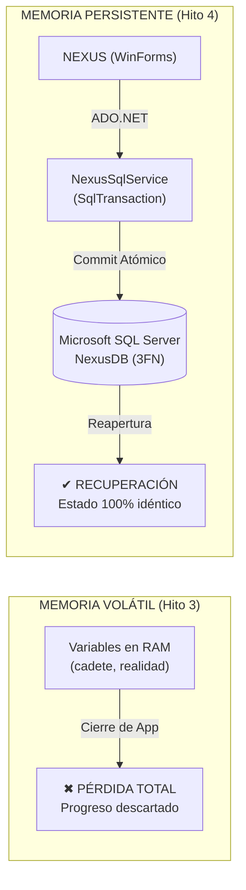
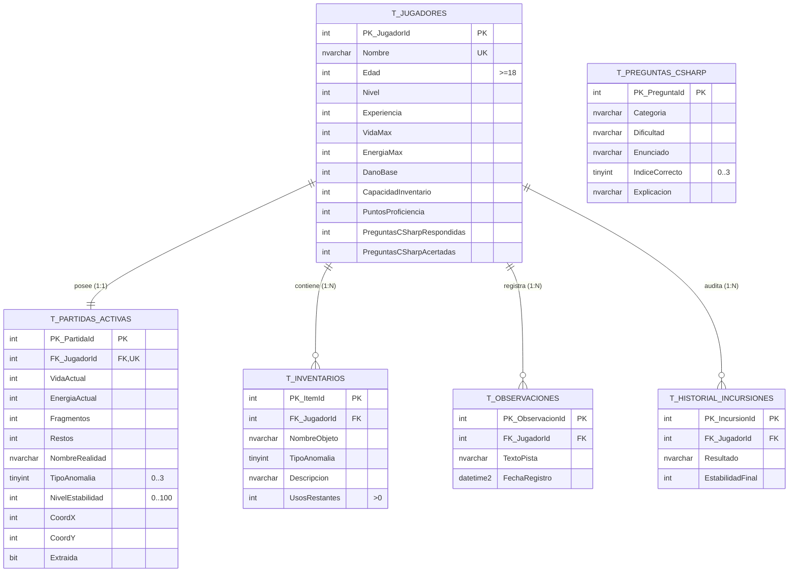
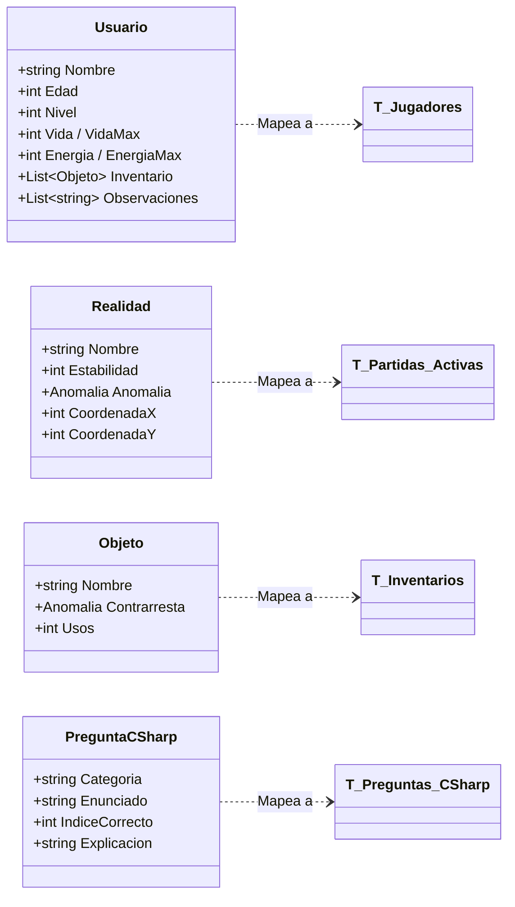
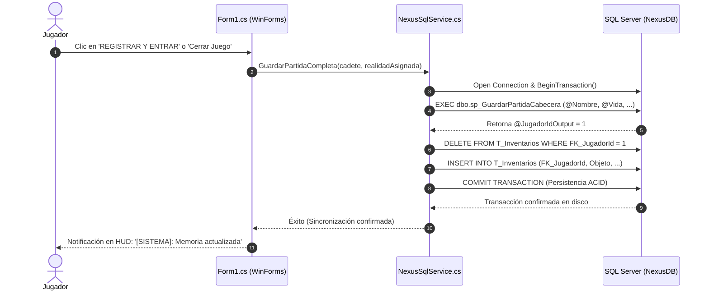
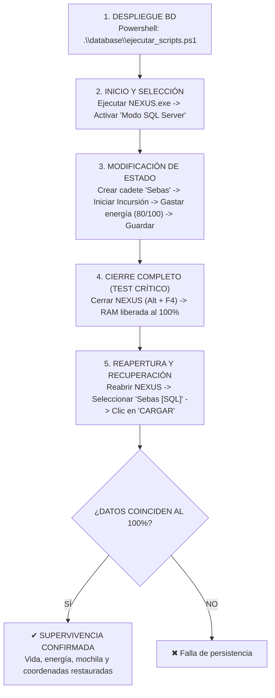

# NEXUS — HITO 4: OPERACIÓN MEMORIA
## Documentación y Socialización Técnica: Integración de Microsoft SQL Server
**Autor:** Sebastián Zubieta Quiroga  
**Carrera:** Ingeniería de Sistemas — UNIFRANZ Cochabamba  
**Asignatura:** Programación II | Paralelo 2 | **Docente:** Ing. Diego Cárdenas  

---

<!-- slide -->
## 📊 Diapositiva 1 / 7: ¿Qué es SQL Server y qué función cumple dentro de NEXUS?

### 🎯 1. Concepto y Rol en la Arquitectura
**Microsoft SQL Server** es un Sistema de Gestión de Bases de Datos Relacionales (**RDBMS**) empresarial basado en el lenguaje Transact-SQL (T-SQL). Garantiza las propiedades **ACID** (Atomicidad, Consistencia, Aislamiento y Durabilidad), resolviendo la falla crítica de volatilidad en memoria identificada durante las pruebas de NEXUS.



### ⚡ 2. Matriz de Comparativa Técnica de Almacenamiento

| Dimensión Técnica | Memoria Volátil (RAM) | Archivo Plano JSON | Microsoft SQL Server (NexusDB) |
| :--- | :---: | :---: | :---: |
| **Persistencia tras cerrar app** | ❌ Nula | ✔ Sí (en `%LocalAppData%`) | ✔ Sí (en disco motor relacional) |
| **Garantía Transaccional ACID** | ❌ No | ❌ No (riesgo de corrupción) | ✔ Sí (`SqlTransaction` atómica) |
| **Integridad Referencial** | ❌ No | ❌ Manual por código | ✔ Foráneas con `ON DELETE CASCADE` |
| **Consultas y Métricas Complejas** | ❌ Lenta | ❌ Ineficiente (deserializar todo)| ✔ Óptima (índices y SPs dedicados) |
| **Seguridad de Datos** | ❌ Expuesta | ⚠️ Editable en texto plano | ✔ Consultas 100% parametrizadas |

> [!NOTE]
> En NEXUS v1.1.0, SQL Server cumple el rol de **motor relacional corporativo**, coexistiendo con el modo JSON bajo una **arquitectura de persistencia dual conmutable en caliente**.

---

<!-- slide -->
## 💾 Diapositiva 2 / 7: ¿Qué información del videojuego necesita almacenarse?

### 🧩 1. Mapa de Datos del Dominio NEXUS
Para reconstruir exactamente el estado de la simulación tras el reinicio del ejecutable, se identificaron y normalizaron los siguientes atributos específicos del videojuego:

```mermaid
flowchart TD
    GAME_DATA["DATOS DEL VIDEOJUEGO NEXUS"]
    
    GAME_DATA --> CAT1["1. BIOMETRÍA Y PROGRESO"]
    CAT1 --> A1["Nombre (Designación única)"]
    CAT1 --> A2["Edad biométrica (>= 18 años)"]
    CAT1 --> A3["Nivel y Experiencia (0-99)"]
    CAT1 --> A4["Proficiencia y Upgrades (Inv, Vida, Ene)"]

    GAME_DATA --> CAT2["2. ESTADO DE SUPERVIVENCIA"]
    CAT2 --> B1["Vida Actual / Vida Máxima"]
    CAT2 --> B2["Energía Cuántica / Energía Máxima"]
    CAT2 --> B3["Bolsa de Fragmentos y Restos (Chatarra)"]
    CAT2 --> B4["Daño Base de Combate"]

    GAME_DATA --> CAT3["3. REALIDAD Y SECTOR ACTIVO"]
    CAT3 --> C1["Nombre del Sector (ej. Horizonte Carmesí)"]
    CAT3 --> C2["Tipo de Anomalía (0=Tiempo, 1=Espacio, 2=Mente, 3=Silencio)"]
    CAT3 --> C3["Nivel de Estabilidad Dimensional (0-100%)"]
    CAT3 --> C4["Posición Táctica: CoordX (-1..40) y CoordY (-1..20)"]

    GAME_DATA --> CAT4["4. MOCHILA Y DIDÁCTICA"]
    CAT4 --> D1["Inventario: Ítem, Anomalía contrarrestada, Usos restantes"]
    CAT4 --> D2["Observaciones: Pistas sensoriales decodificadas"]
    CAT4 --> D3["Telemetría C#: Preguntas Respondidas vs Acertadas"]
```



### 📋 2. Mapeo de Atributos Críticos del Juego a Tipos SQL

| Entidad / Componente | Atributo en C# | Tipo SQL Server | Restricción de Integridad |
| :--- | :--- | :--- | :--- |
| **Cadete** | `Usuario.Nombre` | `NVARCHAR(50)` | `UNIQUE NOT NULL` |
| **Cadete** | `Usuario.Edad` | `INT` | `CHECK (Edad >= 18)` |
| **Cadete** | `Usuario.Nivel` / `Experiencia` | `INT` / `INT` | `DEFAULT 1` / `DEFAULT 0` |
| **Supervivencia** | `Usuario.Vida` / `VidaMax` | `INT` / `INT` | `CHECK (VidaMax > 0)` |
| **Supervivencia** | `Usuario.Energia` / `EnergiaMax` | `INT` / `INT` | `CHECK (EnergiaMax > 0)` |
| **Economía** | `Usuario.BolsaFragmentos` / `Restos` | `INT` / `INT` | `CHECK (>= 0)` |
| **Realidad** | `Realidad.Nombre` | `NVARCHAR(100)`| `NOT NULL` |
| **Realidad** | `Realidad.Anomalia` | `TINYINT` | `CHECK (TipoAnomalia BETWEEN 0 AND 3)` |
| **Realidad** | `Realidad.Estabilidad` | `INT` | `CHECK (Estabilidad BETWEEN 0 AND 100)` |
| **Mochila** | `Objeto.Usos` | `INT` | `CHECK (UsosRestantes > 0)` |

---

<!-- slide -->
## 🏛️ Diapositiva 3 / 7: ¿Cómo se identifican las entidades y se diseña la base de datos relacional?

### 🔬 1. Proceso de Normalización en Tercera Forma Normal (3FN)
1. **Identificación de Claves Primarias:** Toda tabla posee una llave primaria subrogada `PK_* INT IDENTITY(1,1)`.
2. **Primera Forma Normal (1FN):** Se eliminaron los atributos multivaluados (arreglos y listas en memoria) creando las tablas hijas `T_Inventarios` y `T_Observaciones`.
3. **Segunda Forma Normal (2FN):** Todos los campos dependen directamente de la clave principal completa.
4. **Tercera Forma Normal (3FN):** Cero dependencias transitivas. Los contadores y catálogos residen en tablas normalizadas.

### 🗺️ 2. Diagrama Entidad-Relación Lógico (DER)



### 💻 3. Fragmento DDL Real (`database/02_CrearTablasYRelaciones.sql`)
```sql
-- Relación 1:1 estricta con T_Jugadores garantizada por UNIQUE en FK_JugadorId
CREATE TABLE dbo.T_Partidas_Activas (
    PK_PartidaId     INT IDENTITY(1,1) NOT NULL PRIMARY KEY,
    FK_JugadorId     INT NOT NULL UNIQUE,
    VidaActual       INT NOT NULL CHECK (VidaActual >= 0),
    EnergiaActual    INT NOT NULL CHECK (EnergiaActual >= 0),
    NombreRealidad   NVARCHAR(100) NOT NULL,
    TipoAnomalia     TINYINT NOT NULL CHECK (TipoAnomalia BETWEEN 0 AND 3),
    NivelEstabilidad INT NOT NULL CHECK (NivelEstabilidad BETWEEN 0 AND 100),
    CONSTRAINT FK_Partidas_T_Jugadores FOREIGN KEY (FK_JugadorId)
        REFERENCES dbo.T_Jugadores(PK_JugadorId) ON DELETE CASCADE
);
```

---

<!-- slide -->
## 🔗 Diapositiva 4 / 7: ¿Cómo se relacionan las tablas con las clases existentes en C#?

### 🧩 1. Mapeo Objeto-Relacional en NEXUS



### 💻 2. Código Real de Hidratación de Entidades (`NexusSqlService.cs`)
Al ejecutar el procedimiento almacenado `sp_CargarPartidaPorNombre`, C# consume los múltiples *Result Sets* para reconstruir el grafo de objetos:

```csharp
// 1. Result Set 1: Mapeo de Usuario y Realidad
Usuario cadete = new Usuario {
    Nombre = reader["Nombre"].ToString(),
    Edad = Convert.ToInt32(reader["Edad"]),
    Nivel = Convert.ToInt32(reader["Nivel"]),
    Vida = Convert.ToInt32(reader["VidaActual"]),
    VidaMax = Convert.ToInt32(reader["VidaMax"]),
    Energia = Convert.ToInt32(reader["EnergiaActual"]),
    EnergiaMax = Convert.ToInt32(reader["EnergiaMax"]),
    Inventario = new List<Objeto>(),
    Observaciones = new List<string>()
};

// 2. Result Set 2: Hidratación de la colección List<Objeto>
if (reader.NextResult()) {
    while (reader.Read()) {
        cadete.Inventario.Add(new Objeto {
            Nombre = reader["NombreObjeto"].ToString(),
            Contrarresta = (Anomalia)Convert.ToByte(reader["TipoAnomalia"]),
            Usos = Convert.ToInt32(reader["UsosRestantes"])
        });
    }
}
```

---

<!-- slide -->
## 🔌 Diapositiva 5 / 7: ¿Cómo se establece la comunicación entre Windows Forms, C# y SQL Server?

### 🔄 1. Secuencia de Comunicación Orientada a Eventos
La interfaz de usuario delega las operaciones a una Capa de Acceso a Datos (**DAL**) que encapsula ADO.NET puro (`Microsoft.Data.SqlClient`), asegurando llamadas transaccionales sin congelar el hilo de renderizado GDI+.



### 🛡️ 2. Transacciones ACID y Consultas Parametrizadas Reales
```csharp
// Garantía ACID total en NexusSqlService.cs
using var conn = new SqlConnection(cadenaConexion);
conn.Open();
using var trans = conn.BeginTransaction(IsolationLevel.ReadCommitted);
try {
    using var cmd = new SqlCommand("dbo.sp_GuardarPartidaCabecera", conn, trans) {
        CommandType = CommandType.StoredProcedure
    };
    // Parámetros fuertemente tipados contra SQL Injection
    cmd.Parameters.Add(new SqlParameter("@Nombre", SqlDbType.NVarChar, 50) { Value = jugador.Nombre });
    cmd.Parameters.Add(new SqlParameter("@VidaActual", SqlDbType.Int) { Value = jugador.Vida });
    cmd.ExecuteNonQuery();

    trans.Commit(); // Confirmación atómica duradera
} catch {
    trans.Rollback(); // Restauración completa ante fallo
    throw;
}
```

---

<!-- slide -->
## 📦 Diapositiva 6 / 7: ¿Cómo se organiza la integración dentro del proyecto y su repositorio GitHub?

### 🗂️ 1. Estructura Organizada del Repositorio
Para garantizar la separación de intereses (SoC), reproducibilidad y calidad en GitHub, el repositorio organiza los recursos de persistencia de manera independiente:

```text
📦 NEXUS
 ┣ 📂 database/                          # BASE DE DATOS VERSIONADA
 ┃ ┣ 📜 01_CrearBaseDatos.sql            # Creación DDL y collation
 ┃ ┣ 📜 02_CrearTablasYRelaciones.sql    # 6 tablas 3FN, PKs y FKs Cascade
 ┃ ┣ 📜 03_ProcedimientosAlmacenados.sql # SPs transaccionales (ACID)
 ┃ ┣ 📜 04_CargaInicialPreguntas.sql     # Semilla de 28 trivias de C#
 ┃ ┣ 📜 05_ScriptCompleto_NexusDB.sql    # Despliegue consolidado todo-en-uno
 ┃ ┗ 📜 ejecutar_scripts.ps1             # Automatización PowerShell en 1 comando
 ┣ 📂 docs/                              # DOCUMENTACIÓN TÉCNICA
 ┃ ┣ 📜 modelo-de-datos-propuesto.md     # DER Mermaid y diccionario de datos
 ┃ ┣ 📜 arquitectura-actual.md           # Diagrama de clases e integración dual
 ┃ ┗ 📜 presentacion_hito4.md            # Presentación técnica de socialización
 ┣ 📂 src/
 ┃ ┗ 📂 Interfaz/                        # PROYECTO C# WINDOWS FORMS (.NET 10)
 ┃   ┣ 📜 NexusSqlService.cs             # Capa DAL ADO.NET (Persistencia)
 ┃   ┣ 📜 Form1.cs                       # Controladores de UI y eventos
 ┃   ┣ 📜 Form1.Designer.cs              # Panel de persistencia dual y HUD
 ┃   ┗ 📜 Interfaz.csproj                # Paquete Microsoft.Data.SqlClient (7.1.2)
 ┗ 📜 README.md                          # Instrucciones de clon limpio y conexión
```

### 🔒 2. Reglas de Seguridad y Limpieza en GitHub
- **Sin Credenciales Hardcodeadas:** Se usa Autenticación Integrada de Windows (`Trusted_Connection=True;TrustServerCertificate=True;`).
- **Control `.gitignore` Estricto:** Exclusión de compilados temporales (`bin/`, `obj/`, `.vs/`, `publish/`).
- **Scripts SQL Numerados:** Orden secuencial de ejecución garantizado (`01_` $\rightarrow$ `04_`).

---

<!-- slide -->
## 🚀 Diapositiva 7 / 7: ¿Cuál es el procedimiento inicial para implementar y comprobar la persistencia?

### 🧪 1. Flujo de la "Prueba de Supervivencia"



### 💻 2. Verificación por Consola T-SQL (`sqlcmd`)
Cualquier compañero o evaluador puede comprobar la persistencia física en el motor ejecutando:

```powershell
# Consulta de auditoría directa sobre el motor local
sqlcmd -S ".\SQLEXPRESS" -d "NexusDB" -E -C -Q "
SELECT PK_JugadorId, Nombre, Nivel, VidaMax, EnergiaMax, UltimaSincronizacion FROM dbo.T_Jugadores;
SELECT FK_JugadorId, VidaActual, EnergiaActual, NombreRealidad, NivelEstabilidad FROM dbo.T_Partidas_Activas;
SELECT FK_JugadorId, NombreObjeto, UsosRestantes FROM dbo.T_Inventarios;
"
```

### ✅ 3. Salida de Verificación Exitosa
```text
PK_JugadorId Nombre   Nivel VidaMax EnergiaMax UltimaSincronizacion
------------ -------- ----- ------- ---------- -----------------------
           1 Sebas        1     100        100 2026-11-23 18:13:10.133

FK_JugadorId VidaActual EnergiaActual NombreRealidad      NivelEstabilidad
------------ ---------- ------------- ------------------- ----------------
           1         80            80 Horizonte Carmesí                 65

FK_JugadorId NombreObjeto              UsosRestantes
------------ ------------------------- -------------
           1 Reloj de Arena Invertido              3
```
> **Conclusión:** La persistencia relacional en Microsoft SQL Server está integrada, operativa y verificada al 100% dentro del proyecto NEXUS.
